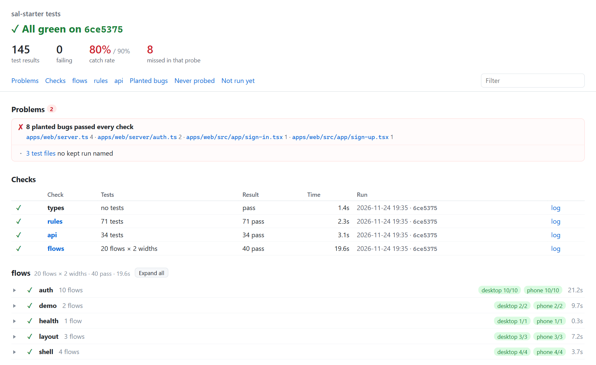
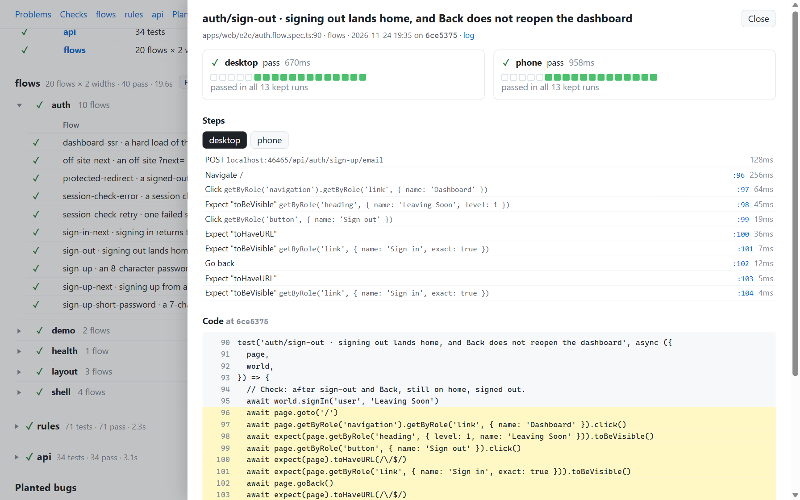

# Examples

Real files from [sal-starter](https://github.com/dested/sal-starter), the reference implementation. Each is cut down to show the shape; the links go to the whole file.

## Types: the sign-in guard in `trpc.ts`

There is no test file. The compiler is the check, and the code is written so it can be one: a signed-in procedure is handed a session that can't be null, and an input is whatever its zod schema says it is.

```ts
export const protectedProcedure = t.procedure.meta({ access: 'user' }).use(({ ctx, next }) => {
  if (!ctx.session) {
    throw new TRPCError({ code: 'UNAUTHORIZED' })
  }
  return next({ ctx: { ...ctx, session: ctx.session } })
})
```

[`apps/web/server/trpc.ts`](https://github.com/dested/sal-starter/blob/main/apps/web/server/trpc.ts)

```ts
create: protectedProcedure
  .input(
    z.object({
      title: z.string().min(1).max(200),
      content: z.string().min(1).max(2000),
    })
  )
  .mutation(async ({ ctx, input }) => {
    return prisma.post.create({
      data: { ...input, authorId: ctx.session.user.id },
    })
  }),
```

[`apps/web/server/demo.ts`](https://github.com/dested/sal-starter/blob/main/apps/web/server/demo.ts)

Take the `!` out of the guard, one of the 40 bugs the planted-bug run tried, and the typecheck names every procedure that assumed a session:

```
$ tsc --noEmit
server/demo.ts(35,37): error TS18047: 'ctx.session' is possibly 'null'.
server/router.ts(5,51): error TS18047: 'ctx.session' is possibly 'null'.
```

## A rule: `access.rule.test.ts`

Who may sign up. Pure, many cases, and silent when wrong: the kind of logic a rule is for.

```ts
import { describe, expect, test } from 'bun:test'
import { emailMatches } from './access'

describe('emailMatches', () => {
  const entries = ['ada@example.com', '@acme.io']

  test('a whole domain, and only that domain', () => {
    expect(emailMatches('anyone@acme.io', entries)).toBe(true)
    expect(emailMatches('x@eng.acme.io', entries)).toBe(false)
    expect(emailMatches('x@notacme.io', entries)).toBe(false)
    expect(emailMatches('x@acme.io.evil.com', entries)).toBe(false)
  })

  test('the last @ decides the domain', () => {
    expect(emailMatches('"a@acme.io"@evil.com', entries)).toBe(false)
  })
})
```

[`apps/web/server/access.rule.test.ts`](https://github.com/dested/sal-starter/blob/main/apps/web/server/access.rule.test.ts)

## An API test: `demo.api.test.ts`

One `describe` per procedure: what it returns, what it writes, what it refuses. The caller is a real session, and the row is read back from a real Postgres.

```ts
import { describe, expect, test } from 'bun:test'
import { asAnon, asUser } from '../test/callers'
import { prisma } from './prisma'

describe('posts.create', () => {
  test('writes a post owned by the caller and returns it', async () => {
    const person = await asUser()
    const created = await person.api.posts.create({ title: 'Hello', content: 'World' })
    const row = await prisma.post.findUniqueOrThrow({ where: { id: created.id } })
    expect(row).toMatchObject({ title: 'Hello', content: 'World', authorId: person.user.id })
  })

  test('rejects a signed-out caller and writes nothing', async () => {
    const before = await prisma.post.count()
    const anon = await asAnon()
    await expect(anon.api.posts.create({ title: 'nope', content: 'nope' })).rejects.toMatchObject({
      code: 'UNAUTHORIZED',
    })
    expect(await prisma.post.count()).toBe(before)
  })
})
```

[`apps/web/server/demo.api.test.ts`](https://github.com/dested/sal-starter/blob/main/apps/web/server/demo.api.test.ts) · callers: [`apps/web/test/callers.ts`](https://github.com/dested/sal-starter/blob/main/apps/web/test/callers.ts) · databases: [`apps/web/test/db.ts`](https://github.com/dested/sal-starter/blob/main/apps/web/test/db.ts)

## Who may call what: `router.access.md`

Generated from the tag on each procedure's builder, committed, and checked by a test. A permission change is a one-line diff here.

```md
| procedure    | kind     | signed out | signed in | admin |
| ---          | ---      | ---        | ---       | ---   |
| me           | query    | no         | yes       | yes   |
| posts.create | mutation | no         | yes       | yes   |
| posts.list   | query    | yes        | yes       | yes   |
```

[`apps/web/server/router.access.md`](https://github.com/dested/sal-starter/blob/main/apps/web/server/router.access.md) · the script: [`apps/web/test/access-table.ts`](https://github.com/dested/sal-starter/blob/main/apps/web/test/access-table.ts)

## A flow: `auth.flow.spec.ts`

The title says what a person sees. The `// Check:` line names the one thing to look for. It imports `test` from the fixture, never from Playwright, and runs at both widths without saying so.

```ts
import { expect, test } from './flow'

test('auth/sign-in-next · signing in returns to the page and query asked for', async ({
  page,
  world,
}) => {
  // Check: sign-in from /dashboard?tab=posts ends on /dashboard?tab=posts.
  const person = await world.account('Linus')
  await page.goto('/dashboard?tab=posts')
  await page.waitForURL('**/sign-in?next=%2Fdashboard%3Ftab%3Dposts')
  await page.getByLabel('Email').fill(person.email)
  await page.getByLabel('Password').fill(person.password)
  await page.getByRole('button', { name: 'Sign in' }).click()
  await page.waitForURL((url) => url.pathname === '/dashboard' && url.search === '?tab=posts')
  await expect(page.getByRole('heading', { level: 1, name: 'Linus' })).toBeVisible()
})
```

[`apps/web/e2e/auth.flow.spec.ts`](https://github.com/dested/sal-starter/blob/main/apps/web/e2e/auth.flow.spec.ts) · the fixture: [`apps/web/e2e/flow.ts`](https://github.com/dested/sal-starter/blob/main/apps/web/e2e/flow.ts) · the every-screen check: [`apps/web/e2e/coverage.ts`](https://github.com/dested/sal-starter/blob/main/apps/web/e2e/coverage.ts)

What the fixture does without being asked, at the end of every flow:

```
no uncaught page error
no console.error
no response of 500 or more, no failed same-origin request
no sideways overflow on the page the flow ended on
```

A flow that provokes one on purpose allows exactly that one:

```ts
problems.allow('response', /\/api\/auth\/get-session/)
```

## Live: `/healthz` reports the deployed commit

The app's half is one field. The deploy tool sets `DRYDOCK_COMMIT` on an app whose live check is on, and the health route hands it back:

```ts
export function healthz(ping: () => Promise<unknown> = pingDatabase): RequestHandler {
  return async (_req, res) => {
    try {
      await ping()
      res.json({ status: 'ok', uptime: process.uptime(), commit: env.DRYDOCK_COMMIT ?? null })
    } catch (e) {
      log.error(`healthz db check failed: ${formatError(e)}`)
      res.status(503).json({ status: 'error', error: 'database unreachable' })
    }
  }
}
```

[`apps/web/server/health.ts`](https://github.com/dested/sal-starter/blob/main/apps/web/server/health.ts)

A flow holds the route to it, on the production build:

```ts
import { expect, test } from './flow'
import { FLOW_COMMIT } from './server'

test('health/commit · /healthz reports the commit the server was deployed as', async ({
  request,
}) => {
  // Check: the body holds `"commit":"<DRYDOCK_COMMIT>"`, the text Drydock's Live check looks for.
  const res = await request.get('/healthz')
  expect(res.status()).toBe(200)
  expect(await res.text()).toContain(`"commit":"${FLOW_COMMIT}"`)
})
```

[`apps/web/e2e/health.flow.spec.ts`](https://github.com/dested/sal-starter/blob/main/apps/web/e2e/health.flow.spec.ts)

The check's half is a few lines in the app's deploy manifest, written by the deploy tool when the check is turned on. `{sha}` stands for the commit that was just deployed, so an old version still serving is reported:

```yaml
liveCheck:        # after each deploy: report whether the new commit serves (never fails it)
  paths:
    - path: "/healthz"
      contains: "\"commit\":\"{sha}\""
```

## `gate.json`

The whole contract between a repo and `gate`: how to set up, which database to make, the four checks, and which files planted bugs go into. This is the starter's.

```json
{
  "version": 1,
  "mode": "report",
  "branches": ["main", "master"],
  "copy": { "env": [".env"], "keep": ["node_modules"] },
  "setup": ["bun install --frozen-lockfile", "bun run db:generate"],
  "databases": [
    {
      "env": "DATABASE_URL",
      "migrate": "bun run db:deploy",
      "key": ["apps/web/prisma/schema.prisma", "apps/web/prisma/migrations"]
    }
  ],
  "ports": [],
  "pass": [],
  "checks": [
    { "name": "types", "run": "bun run typecheck" },
    { "name": "rules", "run": "bun run test:rules" },
    { "name": "api", "run": "bun run test:api" },
    { "name": "flows", "run": "bun run test:flows", "timeout": 900 }
  ],
  "probe": {
    "include": ["apps/web/server.ts", "apps/web/server/**/*.ts", "apps/web/src/**/*.{ts,tsx}"],
    "exclude": [
      { "path": "apps/web/server/logger.ts", "why": "log colours and formatting" },
      { "path": "apps/web/**/*.test.ts", "why": "the tests themselves, not code under test" }
    ]
  }
}
```

[`gate.json`](https://github.com/dested/sal-starter/blob/main/gate.json)

A real app adds the files where a missed bug is never acceptable. A planted-bug run fails if one gets through there, whatever the rate:

```json
"probe": {
  "minRate": 0.9,
  "critical": [
    "apps/web/server/auth.ts",
    "apps/web/server/trpc.ts",
    "apps/web/server/routers/**"
  ]
}
```

## What `gate` prints

A pass, on the starter:

```
gate  sal-starter  c9c25a3  report  clean copy · 1 database
pass  setup    2.3s   1 database from the template cache
pass  types    1.4s
pass  rules    0.3s   53 tests
pass  api      3.2s   32 tests
pass  flows   18.0s   32 tests
receipt written · report mode never blocks a push
```

A failure names the tests and stops:

```
FAIL  api     19.8s   211 passed · 1 failed
      posts.create > rejects a signed-out caller
      …last 40 lines of the log…
 --   flows    not run
FAILED at api. Fix it, commit, run gate again.
```

## What `gate probe` prints

One line per planted bug, then the rate. These lines are from a run of 40 new bugs on the starter:

```
gate probe  sal-starter  6aa609c  40 bugs  baseline types 1.4s · rules 0.3s · api 4.0s · flows 15.2s
caught  rules  apps/web/src/lib/loader.ts:57     flip-rel    safeNext > another host, a scheme or a relative path never does
caught  api    apps/web/server/trpc.ts:59        drop-not    procedure builders > each builder lets in exactly its callers, with the right error for the rest
caught  types  apps/web/server/access.ts:26      flip-eq
caught  flows  apps/web/src/app/sign-in.tsx:18   flip-bool   [desktop] › e2e/auth.flow.spec.ts:63:1 › auth/sign-in-next · signing in returns to the page and query asked for
MISSED         apps/web/server/auth.ts:50        off-by-one  window: 10, → window: 11,
MISSED         apps/web/src/app/sign-up.tsx:26   flip-bool   setLoading(false) → setLoading(true)
…
40 counted · 32 caught (rules 9 · api 2 · types 15 · flows 6) · 8 missed · 0 excluded · 0 stale
catch rate 80%
```

A `caught` line names the check and the test that went red. A `MISSED` line shows the exact change that got through: here, a rate-limit window nobody tests and a sign-up button that would stay stuck on loading. The fix for each is a test that fails on that change.

## What `gate tests` prints

Every test the repo has and how it last ran, read from the runs `gate` kept. It runs nothing. This is the starter:

```
gate tests  sal-starter  c9c25a3
last run   2026-11-21 16:00 · c9c25a3 · pass · HEAD has a receipt
probe      2026-11-21 · 6aa609c · caught 80% · 8 missed

types   no tests              pass                                 1.4s
rules   53 tests              53 pass                              0.3s
api     32 tests              32 pass                              3.2s
flows   16 flows at 2 widths  32 pass                             18.0s

rules
  ✓   4  apps/mobile/src/lib/ota-hold.rule.test.ts         caught none
  ✓   5  apps/mobile/src/lib/resolve-api-url.rule.test.ts  caught none
  ✓   5  apps/web/e2e/screens.rule.test.ts                 caught none
  ✓   8  apps/web/server/access.rule.test.ts               caught 5 planted bugs
  ✓   3  apps/web/server/asset-path.rule.test.ts           caught 4 planted bugs
  ✓   1  apps/web/server/demo.rule.test.ts                 caught none
  ✓   3  apps/web/server/env-schema.rule.test.ts           caught none
  ✓   5  apps/web/src/lib/loader.rule.test.ts              caught 6 planted bugs
  ✓   3  apps/web/src/lib/ssr-state.rule.test.ts           caught none
  ✓   4  apps/web/test/db.rule.test.ts                     caught none
  ✓   6  packages/brand/brand.rule.test.ts                 caught none
  ✓   6  packages/tokens/tokens.rule.test.ts               caught none

api
  ✓   4  apps/desktop/src/main/router.api.test.ts  caught none
  ✓   6  apps/web/server/demo.api.test.ts          caught 1 planted bug
  ✓   1  apps/web/server/prisma.api.test.ts        caught 1 planted bug
  ✓   3  apps/web/server/router.api.test.ts        caught 1 planted bug
  ✓   6  apps/web/server/trpc.api.test.ts          caught 5 planted bugs
  ✓   3  apps/web/test/procedures.api.test.ts      caught none
  ✓   9  packages/trpc-ipc/src/ipc.api.test.ts     caught none

flows                                                                               desktop    phone
  ✓  10  apps/web/e2e/auth.flow.spec.ts  caught 11 planted bugs
    auth/sign-up · an 8-character password signs a new person up onto their dashb…  ✓  1.2s  ✓  1.1s
    auth/sign-up-short-password · a 7-character password is refused in the form     ✓  0.7s  ✓  0.8s
    auth/sign-up-next · signing up from a protected page lands back on it           ✓  1.0s  ✓  1.2s
    auth/protected-redirect · a signed-out visit to the dashboard asks to sign in…  ✓  0.6s  ✓  0.6s
    auth/sign-in-next · signing in returns to the page and query asked for          ✓  1.4s  ✓  1.1s
    auth/off-site-next · an off-site ?next= is ignored                              ✓  1.2s  ✓  0.9s
    auth/sign-out · signing out lands home, and Back does not reopen the dashboard  ✓  0.8s  ✓  1.1s
    auth/dashboard-ssr · a hard load of the dashboard hands React Query a real Da…  ✓  0.8s  ✓  0.7s
    auth/session-check-retry · one failed session check on a navigation still loa…  ✓  1.9s  ✓  2.0s
    auth/session-check-error · a session check that keeps failing shows the error…  ✓  2.0s  ✓  2.0s
  ✓   2  apps/web/e2e/demo.flow.spec.ts  caught 3 planted bugs
    demo/posts-create · a new post shows in the list, before and after a reload     ✓  0.8s  ✓  0.9s
    on an empty database › demo/posts-empty · "No posts yet" until the first post…  ✓  3.4s  ✓  3.3s
  ✓   4  apps/web/e2e/shell.flow.spec.ts  caught 2 planted bugs
    shell/home · the home page shows the product name                               ✓  0.5s  ✓  0.5s
    shell/not-found · an unknown page shows the 404 screen with a 404 status        ✓  0.6s  ✓  0.6s
    shell/not-found-asset · an asset-looking path 404s without the app              ✓  0.1s  ✓  0.2s
    shell/dashboard · the nav link opens the dashboard                              ✓  0.7s  ✓  0.7s

not run yet
  ·  recipes/ai/files/apps/web/server/ai/claude.api.test.ts
  ·  recipes/jobs/files/apps/web/server/jobs.api.test.ts
  ·  recipes/ws/files/apps/web/server/trpc-ws.api.test.ts

caught none: a file can be idle because no bug landed near it
history over the 13 kept runs · every test: gate tests --all · agents: --json
```

Each flow shows both widths side by side. `caught none` next to a file means no stored planted-bug run has gone red in it yet, which can be because no bug landed near it. `not run yet` lists test files that exist at the commit and have no recorded result: here, three files in optional add-ons that no workspace runs.

`gate tests --failed` keeps only what is not a clean pass, `--all` lists every test by name, and `--json` prints everything for an agent. It exits 0 even when the last run was red: `gate` judges, `gate tests` reports.

## The tests page: `gate tests --html`

`gate tests --html` writes the same report as one page and opens it in the browser. It is one file with its styles, script and data inline, and the screenshots beside it, so there is nothing to serve. It runs nothing either. This is the starter:



The top is the answer: green or red and on which commit, how many test results and how many fail, the catch rate of the newest sampled planted-bug run against the bar, and how many bugs it missed. A replay of a list already fixed is never the number on top. Below it:

- **Problems**, left out when there are none: every test that isn't a clean pass, a check that failed with no test to blame, planted bugs that passed every check, coverage maps with gaps, and test files no run named.
- **Checks**: each check's result, count and time, the run and commit its results come from, and its log.
- **Flows** grouped by the feature part of each title, with a column per width. **Rules** and **API** grouped by test file. A group opens by itself when anything in it isn't a clean pass.
- **Planted bugs**: how many were caught of how many planted, each run's catch rate against the bar, and every planted change in each source file, with the line before and after and the check and test that caught it, or that nothing did.
- **Coverage maps** the checks wrote, the **source files no planted bug has landed in**, and the **test files that have not run yet**.

Any test opens on a click, with its own address, so Back closes it:



It shows the result at each width, a square for each kept run, the full error, the screenshots and files the run kept, every step with its locator and time, the test's own code at the commit the run checked with the lines a step ran on lit, and the planted bugs it caught. Steps, errors and failure screenshots need nothing from the repo. A screenshot of every passing flow's last screen needs one line in the Playwright config:

```ts
screenshot: process.env.GATE === '1' ? 'on' : 'only-on-failure',
```

### Coverage maps

A check can say what it covers. While it runs under `gate`, `$GATE_COVERAGE` names an empty folder, and each `<name>.json` the check writes there is drawn on the page as a grid, such as every screen against both widths. A row with a `false` cell is a gap, and the page checks each `coveredBy` title against the last run:

```json
{
  "title": "Screens × widths",
  "columns": ["desktop", "phone"],
  "rows": [
    {
      "item": "/settings",
      "group": "account",
      "cells": { "desktop": true, "phone": false },
      "coveredBy": ["settings/profile · a new name shows after a reload"]
    }
  ]
}
```

A cell is `true` (covered), `false` (a gap), `null` (doesn't apply) or a short text shown as is. Outside `gate` the variable is unset and the check writes nothing.
